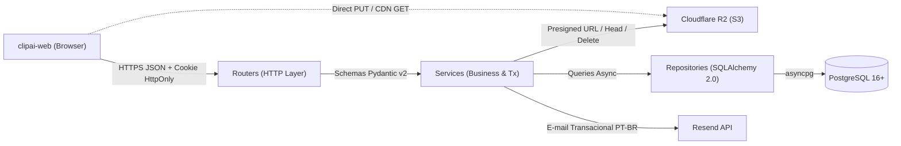

# CLIPAÍ — Backend API (`clipai-api`)

API RESTful **100% assíncrona** do **CLIPAÍ**, plataforma brasileira de armazenamento, descoberta, análise de retenção e compartilhamento de clipes curtos de jogadas (*gaming highlights*).

Este repositório implementa o plano de controle do sistema sobre **Python 3.12+**, **FastAPI**, **SQLAlchemy 2.0 Async (`asyncpg`)** e **PostgreSQL 16+**, operando em conjunto com o frontend [`clipai-web`](https://github.com/Davi-PF/clipai-web). Todo tráfego binário de mídia (vídeos e thumbnails/avatares) ocorre diretamente entre o navegador e o **Cloudflare R2** via **Presigned `PUT` URLs**, mantendo consumo mínimo de banda, CPU e memória na API.

---

## Principais Funcionalidades

- **Autenticação e Segurança de Sessão:**
  - Cadastro com validação de senha forte e hash **Argon2id**.
  - Confirmação de e-mail e recuperação de senha via **Resend** (mensagens em `pt-BR`).
  - `access_token` JWT de curta duração (`15 min`) aliado a `refresh_token` rotativo em cookie `HttpOnly` (`7 dias`) com detecção de reuso por família (`family_id`) e armazenamento exclusivo em hash `SHA-256`.
  - **2FA TOTP** (`PyOTP`) com segredo criptografado em repouso via **Fernet** e 8 códigos de backup de uso único hasheados em `SHA-256`.
  - Login social e vinculação/desvinculação de conta via **Discord OAuth2**.
- **Upload Direto para Cloudflare R2 (Zero Tráfego de Mídia na API):**
  - Emissão de Presigned `PUT` URLs para vídeos (`.mp4`/`.webm` até `100 MB` e `120s`), thumbnails (`.webp`/`.png`/`.jpg` até `5 MB`) e avatares de perfil.
  - Ciclo de vida atômico (`pending_upload` -> `ready` -> `failed`) validado por `HeadObject` no R2 (`confirm-upload`) e limpeza segura de envios abortados (`cancel-upload`).
- **Descoberta, Rankings e Janelas Temporais:**
  - Listagem paginada com busca textual, filtros por jogo, tag, autor, coleção e privacidade (`public`, `friends`, `unlisted`).
  - Modos de ordenação dedicados: `recent`, `popular`, `featured` (**Destaques** ponderados por `favorites * 2 + likes`) e `most_viewed` (**Mais Vistos**), com filtro temporal (`7d`, `30d`, `all`) apoiado por eventos indexados (`clip_likes`, `clip_favorites`, `clip_views`) e marcação determinística `is_top_highlight`.
- **Social, Coleções e Estúdio do Criador:**
  - Curtidas e favoritos idempotentes com contadores atômicos, coleções ordenáveis (playlists) e perfil público com estatísticas agregadas.
  - Telemetria de sessões de visualização (`clip_watch_sessions`) com faixas de retenção de `0%` a `100%` e endpoints analíticos do **Estúdio do Criador** (`/api/v1/analytics/*`).

---

## Stack Tecnológica

| Camada | Tecnologias |
| :--- | :--- |
| **Linguagem & Framework** | Python 3.12+, FastAPI, Uvicorn |
| **Banco de Dados & ORM** | PostgreSQL 16+ (Neon / Supabase), SQLAlchemy 2.0 Async, `asyncpg`, Alembic |
| **Validação & Configuração** | Pydantic v2, `pydantic-settings` |
| **Segurança & Criptografia** | `argon2-cffi` (Argon2id), `PyJWT`, `pyotp`, `cryptography` (Fernet) |
| **Armazenamento & E-mail** | Cloudflare R2 (`boto3` encapsulado com `asyncio.to_thread`), Resend (`httpx`) |
| **Qualidade, Testes & CI/CD** | `pytest`, `pytest-asyncio`, `pytest-cov`, `httpx`, `Ruff`, GitHub Actions, SonarCloud, Railway |

---

## Arquitetura em Camadas

O código segue separação estrita e unidirecional (`routers` -> `services` -> `repositories` -> `models`):



```text
clipai-api/
├── alembic/                    # Configuração assíncrona e migrations versionadas
├── app/
│   ├── core/                   # Settings, engine asyncpg, segurança, rate limit e erros PT-BR
│   ├── models/                 # Entidades ORM SQLAlchemy 2.0 (User, Clip, Collection, Telemetry...)
│   ├── schemas/                # DTOs de entrada/saída em Pydantic v2
│   ├── repositories/           # Queries assíncronas (flush sem commit)
│   ├── services/               # Regras de negócio, transações (commit), R2 e Resend
│   ├── routers/                # Rotas HTTP (/health, /auth, /users, /games, /tags, /clips, /collections, /analytics)
│   └── main.py                 # Factory FastAPI, CORS, handlers globais e lifespan
├── docs/                       # Especificação completa (PRD, Banco, Contrato REST, Segurança, Git)
├── tests/
│   ├── unit/                   # Testes unitários isolados de serviços, repositórios e segurança
│   └── integration/            # Testes ponta a ponta dos routers via httpx.AsyncClient
├── .env.example
├── pyproject.toml
└── railway.toml
```

---

## Como Executar Localmente

### 1. Pré-requisitos
- **Python 3.12+**
- Instância **PostgreSQL 16+** acessível (local via Docker ou remota via Neon/Supabase)
- Bucket **Cloudflare R2** configurado (para testar upload real de mídia)

### 2. Instalação do ambiente virtual e dependências
```powershell
# Criar e ativar virtualenv (Windows PowerShell)
python -m venv .venv
.\.venv\Scripts\Activate.ps1

# Instalar pacote e dependências de desenvolvimento
pip install -e ".[dev]"
```

*(No Linux/macOS, ative com `source .venv/bin/activate`.)*

### 3. Configuração das variáveis de ambiente
Copie o arquivo de exemplo e preencha suas credenciais locais:
```powershell
Copy-Item .env.example .env
```

Dica para gerar chaves seguras localmente:
```powershell
# JWT_SECRET_KEY (64 hex chars)
python -c "import secrets; print(secrets.token_hex(32))"

# TOTP_ENCRYPTION_KEY (Fernet Base64 32 bytes)
python -c "from cryptography.fernet import Fernet; print(Fernet.generate_key().decode())"
```

> Em `APP_ENV="development"`, caso `RESEND_API_KEY` esteja vazio, os links de verificação de e-mail e redefinição de senha são registrados no log do console para facilitar o desenvolvimento local.

### 4. Executar migrations e iniciar o servidor
```powershell
# Aplicar todas as migrations no PostgreSQL
alembic upgrade head

# Iniciar servidor FastAPI com hot-reload
uvicorn app.main:app --reload --host 0.0.0.0 --port 8000
```

- **API Base:** `http://localhost:8000/api/v1`
- **Healthcheck:** `http://localhost:8000/api/v1/health`
- **Swagger UI (apenas fora de `production`):** `http://localhost:8000/docs`

---

## Principais Variáveis de Ambiente

| Variável | Obrigatória | Descrição |
| :--- | :---: | :--- |
| `APP_ENV` | Sim | `development`, `staging` ou `production` (desativa `/docs` em produção) |
| `FRONTEND_URL` / `CORS_ALLOWED_ORIGINS` | Sim | Origem do `clipai-web` para CORS e links transacionais (`http://localhost:3000`) |
| `DATABASE_URL` | Sim | URL assíncrona PostgreSQL (`postgresql+asyncpg://...`) |
| `JWT_SECRET_KEY` | Sim | Segredo para assinatura dos tokens JWT |
| `TOTP_ENCRYPTION_KEY` | Sim (2FA) | Chave Fernet para criptografar segredos TOTP em repouso |
| `DISCORD_CLIENT_ID` / `DISCORD_CLIENT_SECRET` | Opcional | Credenciais OAuth2 do aplicativo no Discord Developer Portal |
| `R2_ACCOUNT_ID`, `R2_ACCESS_KEY_ID`, `R2_SECRET_ACCESS_KEY` | Sim | Credenciais S3 do Cloudflare R2 |
| `R2_BUCKET_NAME`, `R2_PUBLIC_BASE_URL` | Sim | Nome do bucket e URL pública da CDN de mídia |
| `RESEND_API_KEY`, `EMAIL_FROM_ADDRESS` | Produção | Chave da API do Resend e remetente verificado |

Consulte [`.env.example`](.env.example) para a lista completa de parâmetros e limites configuráveis.

---

## Visão Geral dos Endpoints (`/api/v1`)

| Prefixo | Descrição |
| :--- | :--- |
| `/api/v1/health` | Verificação de saúde da aplicação e conectividade com o PostgreSQL |
| `/api/v1/auth` | Registro, verificação de e-mail, login, desafio 2FA, refresh rotativo, logout, reset de senha e Discord OAuth2 |
| `/api/v1/users` | Perfil autenticado (`/me`), upload de avatar no R2, configuração de 2FA TOTP, perfil público e favoritos |
| `/api/v1/games` & `/api/v1/tags` | Catálogo paginado de jogos e listagem/autocompletar de tags populares |
| `/api/v1/clips` | Presigned upload, confirmação/cancelamento, feed com filtros (`sort`, `period`), detalhes, edição, exclusão, views, likes, favoritos e telemetria |
| `/api/v1/collections` | CRUD de coleções e gerenciamento ordenado de clipes na playlist |
| `/api/v1/analytics` | KPIs consolidados, séries diárias, desempenho por jogo e curvas de retenção do Estúdio do Criador |

---

## Qualidade de Código e Testes

Antes de qualquer commit ou Pull Request, execute a suíte completa de verificação (cobertura mínima exigida de **80%** e aprovação no Quality Gate do **SonarCloud**):

```powershell
# Análise estática e regras de segurança/complexidade
ruff check .

# Verificação de formatação
ruff format --check .

# Testes unitários e de integração com cobertura
pytest --cov=app --cov-fail-under=80
```

---

## Documentação Técnica (`/docs`)

Toda decisão de produto, banco de dados, contrato HTTP e segurança está documentada em `/docs`:

- [`docs/PRD.md`](docs/PRD.md) — Requisitos de produto, regras de negócio e ciclo de vida de clipes.
- [`docs/DATABASE.md`](docs/DATABASE.md) — Modelagem relacional completa, ERD, índices e `technical_metadata`.
- [`docs/API_CONTRACT.md`](docs/API_CONTRACT.md) — Contrato REST detalhado sincronizado com o `clipai-web`.
- [`docs/ARCHITECTURE.md`](docs/ARCHITECTURE.md) — Arquitetura em camadas, integrações externas e deploy no Railway.
- [`docs/SECURITY.md`](docs/SECURITY.md) — Argon2id, rotação de Refresh Token, CORS, proteção do R2, rate limiting e 2FA.
- [`docs/GIT_WORKFLOW.md`](docs/GIT_WORKFLOW.md) — GitHub Flow, nomenclatura de branches e política de commits atômicos.
