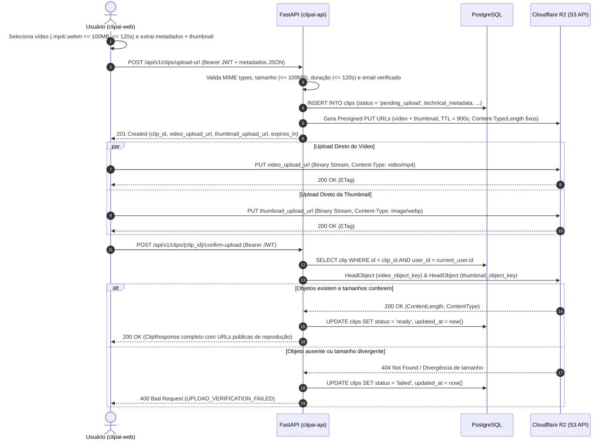

# REST API Contract (`/api/v1`) — CLIPAÍ

## 1. Convenções Gerais

- **Base URL:** `/api/v1`
- **Formato de Payload:** `application/json; charset=utf-8`
- **Nomenclatura JSON:** `snake_case` em todos os campos de request e response.
- **Timestamps:** ISO 8601 em UTC (ex.: `2026-11-21T22:15:00Z`).
- **Idioma:** Chaves JSON e códigos internos (`error.code`) em inglês; mensagens voltadas ao usuário final (`error.message`, `detail`) em **português do Brasil (PT-BR)**.

### 1.1. Headers Padrão
| Header | Obrigatório? | Descrição |
| :--- | :---: | :--- |
| `Content-Type: application/json` | Sim (em `POST`/`PATCH`) | Tipo de mídia das requisições à API. |
| `Authorization: Bearer <access_token>` | Rotas autenticadas | Token JWT de acesso (TTL: 15 minutos). |
| `Cookie: clipai_refresh_token=<token>` | `/auth/refresh` e `/auth/logout` | Cookie `HttpOnly; Secure; SameSite=Lax; Path=/api/v1/auth`. |

### 1.2. Envelope Padronizado de Paginação
Todas as rotas de listagem aceitam os query params `page` (default: `1`, mín: `1`) e `page_size` (default: `20`, mín: `1`, máx: `50`) e retornam:

```json
{
  "items": [],
  "page": 1,
  "page_size": 20,
  "total": 142,
  "total_pages": 8
}
```

### 1.3. Formato Padronizado de Erro
Qualquer resposta com status `4xx` ou `5xx` segue estritamente este contrato:

```json
{
  "error": {
    "code": "VALIDATION_ERROR",
    "message": "Os dados enviados são inválidos. Verifique os campos e tente novamente.",
    "details": [
      {
        "field": "video_size_bytes",
        "message": "O arquivo de vídeo não pode ultrapassar 100 MB."
      }
    ],
    "request_id": "req_01JDF8K2M4N6P8Q0R2S4T6V8X0"
  }
}
```

#### Catálogo de Códigos de Erro (`error.code`)
| HTTP Status | `error.code` | Mensagem Padrão (PT-BR) |
| :---: | :--- | :--- |
| `400` | `BAD_REQUEST` | `"Não foi possível processar a requisição."` |
| `400` | `UPLOAD_VERIFICATION_FAILED` | `"Não foi possível confirmar o envio do arquivo no servidor de mídia."` |
| `401` | `INVALID_CREDENTIALS` | `"E-mail ou senha incorretos."` |
| `401` | `TOKEN_EXPIRED` | `"Sua sessão expirou. Faça login novamente."` |
| `401` | `INVALID_TOKEN` | `"Token de autenticação inválido ou revogado."` |
| `403` | `EMAIL_NOT_VERIFIED` | `"Confirme seu endereço de e-mail antes de realizar esta ação."` |
| `403` | `FORBIDDEN` | `"Você não tem permissão para acessar ou alterar este recurso."` |
| `404` | `RESOURCE_NOT_FOUND` | `"O recurso solicitado não foi encontrado."` |
| `409` | `CONFLICT` | `"Já existe um registro com os dados informados."` |
| `413` | `FILE_TOO_LARGE` | `"O tamanho do arquivo excede o limite máximo permitido."` |
| `415` | `UNSUPPORTED_MEDIA_TYPE` | `"Formato de arquivo não suportado. Use apenas MP4 ou WebM."` |
| `422` | `VALIDATION_ERROR` | `"Os dados enviados são inválidos. Verifique os campos e tente novamente."` |
| `429` | `RATE_LIMIT_EXCEEDED` | `"Muitas tentativas em sequência. Aguarde alguns instantes e tente novamente."` |
| `500` | `INTERNAL_SERVER_ERROR` | `"Ocorreu um erro interno inesperado. Tente novamente mais tarde."` |

---

## 2. Fluxo Sequencial de Upload via Presigned URL (Cloudflare R2)

Os arquivos de vídeo e thumbnail **nunca trafegam pelo servidor FastAPI**. O fluxo obrigatório em 3 fases está ilustrado abaixo:



---

## 3. Endpoints — Healthcheck

### `GET /api/v1/health`
Verifica a disponibilidade da API e a conectividade com o PostgreSQL.
- **Auth:** Público
- **Response `200 OK`:**
```json
{
  "status": "ok",
  "version": "1.0.0",
  "database": "connected"
}
```

---

## 4. Endpoints — Autenticação (`/api/v1/auth`)

### 4.1. `POST /api/v1/auth/register`
Registra um novo usuário e dispara o e-mail de confirmação via Resend.
- **Auth:** Público (Rate limit: 5 req/min por IP)
- **Request Body:**
```json
{
  "username": "fallen_br",
  "email": "gabriel@exemplo.com.br",
  "password": "StrongPassword!2026",
  "display_name": "Gabriel Toledo"
}
```
- **Response `201 Created`:**
```json
{
  "message": "Cadastro realizado com sucesso. Verifique sua caixa de entrada para confirmar seu e-mail.",
  "user": {
    "id": "550e8400-e29b-41d4-a716-446655440000",
    "username": "fallen_br",
    "email": "gabriel@exemplo.com.br",
    "display_name": "Gabriel Toledo",
    "is_email_verified": false,
    "is_2fa_enabled": false,
    "created_at": "2026-11-21T22:00:00Z"
  }
}
```
- **Erros:** `409 CONFLICT` (e-mail ou username já em uso), `422 VALIDATION_ERROR`.

---

### 4.2. `POST /api/v1/auth/verify-email`
Confirma o e-mail do usuário a partir do token enviado por e-mail.
- **Auth:** Público
- **Request Body:**
```json
{
  "token": "eyJhbGciOiJIUzI1NiIsInR5cCI6IkpXVCJ9..."
}
```
- **Response `200 OK`:**
```json
{
  "message": "E-mail confirmado com sucesso. Sua conta está pronta para uso."
}
```
- **Erros:** `400 INVALID_TOKEN`, `401 TOKEN_EXPIRED`.

---

### 4.3. `POST /api/v1/auth/resend-verification`
Reenvia o e-mail de confirmação caso a conta ainda não esteja verificada.
- **Auth:** Público (Rate limit: 3 req/15min por IP/e-mail)
- **Request Body:**
```json
{
  "email": "gabriel@exemplo.com.br"
}
```
- **Response `200 OK`:**
```json
{
  "message": "Se o e-mail estiver cadastrado e pendente de confirmação, um novo link foi enviado."
}
```

---

### 4.4. `POST /api/v1/auth/login`
Autentica o usuário, retorna o `access_token` no corpo JSON e define o cookie `clipai_refresh_token` (`HttpOnly; Secure; SameSite=Lax; Path=/api/v1/auth; Max-Age=604800`).
- **Auth:** Público (Rate limit: 10 req/min por IP)
- **Request Body:**
```json
{
  "email": "gabriel@exemplo.com.br",
  "password": "StrongPassword!2026"
}
```
- **Response `200 OK`:**
```json
{
  "access_token": "eyJhbGciOiJIUzI1NiIsInR5cCI6IkpXVCJ9...",
  "token_type": "bearer",
  "expires_in": 900,
  "requires_2fa": false,
  "temp_2fa_token": null,
  "user": {
    "id": "550e8400-e29b-41d4-a716-446655440000",
    "username": "fallen_br",
    "email": "gabriel@exemplo.com.br",
    "display_name": "Gabriel Toledo",
    "avatar_url": null,
    "is_email_verified": true,
    "is_2fa_enabled": false
  }
}
```
> **Contrato reservado para v1.1 (2FA TOTP):** Os campos `requires_2fa` (booleano) e `temp_2fa_token` (`string | null`) já fazem parte do schema de resposta do login desde a v1.0. Na v1.0, `requires_2fa` é sempre `false` e `temp_2fa_token` é `null`. Na v1.1, quando `user.is_2fa_enabled == true`, o login retornará `requires_2fa: true`, `access_token: null` e um `temp_2fa_token` de 5 minutos para ser trocado em `POST /api/v1/auth/2fa/verify`.

---

### 4.5. `POST /api/v1/auth/refresh`
Rotaciona o Refresh Token lido do cookie `clipai_refresh_token`, revoga o anterior, emite um novo cookie `HttpOnly` e retorna um novo `access_token`.
- **Auth:** Cookie `clipai_refresh_token`
- **Request Body:** Nenhum
- **Response `200 OK`:**
```json
{
  "access_token": "eyJhbGciOiJIUzI1NiIsInR5cCI6IkpXVCJ9...",
  "token_type": "bearer",
  "expires_in": 900
}
```
- **Erros:** `401 INVALID_TOKEN` (inclusive quando detectado reuso de token já rotacionado, revogando toda a `family_id`).

---

### 4.6. `POST /api/v1/auth/logout`
Revoga o Refresh Token atual no banco de dados e limpa o cookie `clipai_refresh_token` (`Max-Age=0`).
- **Auth:** Cookie `clipai_refresh_token` (ou Bearer JWT)
- **Response `204 No Content`**

---

### 4.7. `POST /api/v1/auth/forgot-password`
Envia e-mail transacional via Resend com link de recuperação de senha (TTL: 30 minutos).
- **Auth:** Público (Rate limit: 3 req/15min por IP)
- **Request Body:**
```json
{
  "email": "gabriel@exemplo.com.br"
}
```
- **Response `200 OK`:**
```json
{
  "message": "Se o endereço de e-mail estiver cadastrado, enviamos as instruções para redefinir sua senha."
}
```

---

### 4.8. `POST /api/v1/auth/reset-password`
Redefine a senha do usuário usando o token recebido por e-mail e revoga todas as sessões (`refresh_tokens`) existentes.
- **Auth:** Público
- **Request Body:**
```json
{
  "token": "eyJhbGciOiJIUzI1NiIsInR5cCI6IkpXVCJ9...",
  "new_password": "NewStrongPassword!2026"
}
```
- **Response `200 OK`:**
```json
{
  "message": "Sua senha foi redefinida com sucesso. Faça login com a nova senha."
}
```

---

## 5. Endpoints — Usuários (`/api/v1/users`)

### 5.1. `GET /api/v1/users/me`
Retorna os dados completos do perfil do usuário autenticado.
- **Auth:** Bearer JWT obrigatório
- **Response `200 OK`:**
```json
{
  "id": "550e8400-e29b-41d4-a716-446655440000",
  "username": "fallen_br",
  "email": "gabriel@exemplo.com.br",
  "display_name": "Gabriel Toledo",
  "avatar_url": "https://cdn.clipai.com.br/avatars/550e8400.webp",
  "bio": "AWPer e criador de conteúdo.",
  "is_email_verified": true,
  "is_2fa_enabled": false,
  "created_at": "2026-11-21T22:00:00Z"
}
```

### 5.2. `PATCH /api/v1/users/me`
Atualiza informações de perfil do usuário autenticado.
- **Auth:** Bearer JWT obrigatório
- **Request Body:**
```json
{
  "display_name": "FalleN",
  "bio": "Professor do CS2.",
  "avatar_url": "https://cdn.clipai.com.br/avatars/550e8400.webp"
}
```
- **Response `200 OK`:** Objeto do usuário atualizado (mesmo formato de `GET /api/v1/users/me`).

### 5.3. `GET /api/v1/users/me/favorites`
Lista paginada dos clipes favoritados pelo usuário autenticado.
- **Auth:** Bearer JWT obrigatório
- **Query Params:** `page`, `page_size`
- **Response `200 OK`:** Envelope paginado contendo objetos `ClipSummaryResponse`.

### 5.4. `GET /api/v1/users/{username}`
Retorna o perfil público de um usuário pelo `username`.
- **Auth:** Público
- **Response `200 OK`:**
```json
{
  "id": "550e8400-e29b-41d4-a716-446655440000",
  "username": "fallen_br",
  "display_name": "FalleN",
  "avatar_url": "https://cdn.clipai.com.br/avatars/550e8400.webp",
  "bio": "Professor do CS2.",
  "created_at": "2026-11-21T22:00:00Z"
}
```

### 5.5. `GET /api/v1/users/{username}/clips`
Lista os clipes com `status = 'ready'` de um usuário. Se o solicitante for o próprio dono do perfil (autenticado via JWT), permite filtrar também seus clipes `unlisted` e `friends`; caso contrário, retorna apenas `privacy = 'public'`.
- **Auth:** Opcional (Bearer JWT expande visibilidade para o próprio autor)
- **Query Params:** `page`, `page_size`, `privacy` (opcional, apenas para o próprio autor)
- **Response `200 OK`:** Envelope paginado de `ClipSummaryResponse`.

---

## 6. Endpoints — Jogos e Tags (`/api/v1/games`, `/api/v1/tags`)

### 6.1. `GET /api/v1/games`
Lista jogos cadastrados com busca opcional por nome.
- **Auth:** Público
- **Query Params:** `q` (opcional, busca parcial por nome), `page`, `page_size`
- **Response `200 OK`:**
```json
{
  "items": [
    {
      "id": "7c9e6679-7425-40de-944b-e07fc1f90ae7",
      "name": "Counter-Strike 2",
      "slug": "counter-strike-2",
      "cover_url": "https://cdn.clipai.com.br/games/cs2.webp"
    }
  ],
  "page": 1,
  "page_size": 20,
  "total": 1,
  "total_pages": 1
}
```

### 6.2. `GET /api/v1/tags`
Lista as tags mais utilizadas ou filtradas por prefixo.
- **Auth:** Público
- **Query Params:** `q` (opcional), `limit` (default: `20`, máx: `50`)
- **Response `200 OK`:**
```json
{
  "items": [
    {
      "id": "2a4e6679-7425-40de-944b-e07fc1f90111",
      "name": "clutch",
      "slug": "clutch"
    }
  ]
}
```

---

## 7. Endpoints — Clipes (`/api/v1/clips`)

### 7.1. `POST /api/v1/clips/upload-url`
Valida os metadados do vídeo e da thumbnail, cria o registro `pending_upload` no banco e retorna as Presigned `PUT` URLs do Cloudflare R2.
- **Auth:** Bearer JWT obrigatório (`is_email_verified = true`)
- **Request Body:**
```json
{
  "title": "Clutch 1v4 de AWP na Mirage",
  "description": "Round decisivo na prorrogação.",
  "game_id": "7c9e6679-7425-40de-944b-e07fc1f90ae7",
  "privacy": "public",
  "tags": ["clutch", "awp", "mirage"],
  "video_mime_type": "video/mp4",
  "video_size_bytes": 48234496,
  "duration_seconds": 34.5,
  "thumbnail_mime_type": "image/webp",
  "thumbnail_size_bytes": 184320,
  "technical_metadata": {
    "codec": "h264",
    "container": "mp4",
    "width": 1920,
    "height": 1080,
    "resolution_label": "1080p",
    "fps": 60,
    "bitrate_kbps": 11180,
    "audio_codec": "aac",
    "audio_channels": 2,
    "aspect_ratio": "16:9"
  }
}
```
- **Response `201 Created`:**
```json
{
  "clip_id": "9b1deb4d-3b7d-4bad-9bdd-2b0d7b3dcb6d",
  "status": "pending_upload",
  "expires_in": 900,
  "video_upload": {
    "url": "https://<account_id>.r2.cloudflarestorage.com/clipai-media/clips/550e.../9b1d.../video.mp4?X-Amz-Algorithm=AWS4-HMAC-SHA256...",
    "method": "PUT",
    "headers": {
      "Content-Type": "video/mp4",
      "Content-Length": "48234496"
    }
  },
  "thumbnail_upload": {
    "url": "https://<account_id>.r2.cloudflarestorage.com/clipai-media/clips/550e.../9b1d.../thumb.webp?X-Amz-Algorithm=AWS4-HMAC-SHA256...",
    "method": "PUT",
    "headers": {
      "Content-Type": "image/webp",
      "Content-Length": "184320"
    }
  }
}
```
- **Erros:** `403 EMAIL_NOT_VERIFIED`, `413 FILE_TOO_LARGE`, `415 UNSUPPORTED_MEDIA_TYPE`, `422 VALIDATION_ERROR`.

---

### 7.2. `POST /api/v1/clips/{clip_id}/confirm-upload`
Confirma que o upload direto ao Cloudflare R2 foi concluído, executa `HeadObject` no R2 e altera o `status` do clipe de `pending_upload` para `ready`.
- **Auth:** Bearer JWT obrigatório (apenas o autor do clipe)
- **Request Body:** Nenhum
- **Response `200 OK`:** Objeto `ClipDetailResponse` (ver `GET /api/v1/clips/{clip_id}`).
- **Erros:** `400 UPLOAD_VERIFICATION_FAILED`, `403 FORBIDDEN`, `404 RESOURCE_NOT_FOUND`.

---

### 7.3. `GET /api/v1/clips`
Lista paginada de clipes públicos (`status = 'ready'` e `privacy = 'public'`) com suporte a busca e filtros.
- **Auth:** Opcional (se autenticado, preenche `is_liked_by_me` e `is_favorited_by_me`)
- **Query Params:**
  - `q` (opcional): Busca textual em `title` e `description`
  - `game_slug` (opcional): Filtra pelo slug do jogo
  - `game_id` (opcional): Filtra pelo UUID do jogo
  - `tag` (opcional): Filtra pelo slug da tag
  - `sort` (opcional): `recent` (default) ou `popular`
  - `page` (default: `1`), `page_size` (default: `20`, máx: `50`)
- **Response `200 OK`:**
```json
{
  "items": [
    {
      "id": "9b1deb4d-3b7d-4bad-9bdd-2b0d7b3dcb6d",
      "title": "Clutch 1v4 de AWP na Mirage",
      "privacy": "public",
      "video_url": "https://cdn.clipai.com.br/clips/550e.../9b1d.../video.mp4",
      "thumbnail_url": "https://cdn.clipai.com.br/clips/550e.../9b1d.../thumb.webp",
      "duration_seconds": 34.5,
      "views_count": 128,
      "likes_count": 24,
      "favorites_count": 7,
      "is_liked_by_me": false,
      "is_favorited_by_me": false,
      "author": {
        "id": "550e8400-e29b-41d4-a716-446655440000",
        "username": "fallen_br",
        "display_name": "FalleN",
        "avatar_url": "https://cdn.clipai.com.br/avatars/550e8400.webp"
      },
      "game": {
        "id": "7c9e6679-7425-40de-944b-e07fc1f90ae7",
        "name": "Counter-Strike 2",
        "slug": "counter-strike-2"
      },
      "tags": ["clutch", "awp", "mirage"],
      "created_at": "2026-11-21T22:05:00Z"
    }
  ],
  "page": 1,
  "page_size": 20,
  "total": 1,
  "total_pages": 1
}
```

---

### 7.4. `GET /api/v1/clips/{clip_id}`
Retorna os detalhes completos de um clipe (`status = 'ready'`), respeitando sua configuração de `privacy` (`public` e `unlisted` acessíveis por qualquer pessoa com o link; `friends` restrito ao autor no MVP).
- **Auth:** Opcional (obrigatório para visualizar clipe `friends` do próprio autor)
- **Response `200 OK` (`ClipDetailResponse`):**
```json
{
  "id": "9b1deb4d-3b7d-4bad-9bdd-2b0d7b3dcb6d",
  "title": "Clutch 1v4 de AWP na Mirage",
  "description": "Round decisivo na prorrogação.",
  "status": "ready",
  "privacy": "public",
  "video_url": "https://cdn.clipai.com.br/clips/550e.../9b1d.../video.mp4",
  "thumbnail_url": "https://cdn.clipai.com.br/clips/550e.../9b1d.../thumb.webp",
  "file_size_bytes": 48234496,
  "duration_seconds": 34.5,
  "mime_type": "video/mp4",
  "technical_metadata": {
    "codec": "h264",
    "container": "mp4",
    "width": 1920,
    "height": 1080,
    "resolution_label": "1080p",
    "fps": 60,
    "bitrate_kbps": 11180,
    "audio_codec": "aac",
    "audio_channels": 2,
    "aspect_ratio": "16:9"
  },
  "views_count": 128,
  "likes_count": 24,
  "favorites_count": 7,
  "is_liked_by_me": true,
  "is_favorited_by_me": false,
  "author": {
    "id": "550e8400-e29b-41d4-a716-446655440000",
    "username": "fallen_br",
    "display_name": "FalleN",
    "avatar_url": "https://cdn.clipai.com.br/avatars/550e8400.webp"
  },
  "game": {
    "id": "7c9e6679-7425-40de-944b-e07fc1f90ae7",
    "name": "Counter-Strike 2",
    "slug": "counter-strike-2"
  },
  "tags": ["clutch", "awp", "mirage"],
  "created_at": "2026-11-21T22:05:00Z",
  "updated_at": "2026-11-21T22:06:10Z"
}
```

---

### 7.5. `PATCH /api/v1/clips/{clip_id}`
Atualiza título, descrição, jogo, privacidade ou tags de um clipe pertencente ao usuário.
- **Auth:** Bearer JWT obrigatório (apenas o autor do clipe)
- **Request Body:**
```json
{
  "title": "Clutch 1v4 de AWP na Mirage (OT)",
  "description": "Round decisivo na prorrogação da Mirage.",
  "game_id": "7c9e6679-7425-40de-944b-e07fc1f90ae7",
  "privacy": "unlisted",
  "tags": ["clutch", "awp", "cs2"]
}
```
- **Response `200 OK`:** `ClipDetailResponse` atualizado.

---

### 7.6. `DELETE /api/v1/clips/{clip_id}`
Remove o clipe do banco de dados e exclui os objetos de vídeo e thumbnail correspondentes no Cloudflare R2.
- **Auth:** Bearer JWT obrigatório (apenas o autor do clipe)
- **Response `204 No Content`**

---

### 7.7. `POST /api/v1/clips/{clip_id}/views`
Registra uma visualização no clipe e incrementa `views_count`.
- **Auth:** Opcional (Rate limit: 1 incremento por IP/usuário por `clip_id` a cada 10 minutos)
- **Response `200 OK`:**
```json
{
  "clip_id": "9b1deb4d-3b7d-4bad-9bdd-2b0d7b3dcb6d",
  "views_count": 129
}
```

---

### 7.8. Curtidas e Favoritos em Clipes
- **`POST /api/v1/clips/{clip_id}/like`** — Curte o clipe (idempotente). Auth: Bearer JWT (`is_email_verified = true`).
- **`DELETE /api/v1/clips/{clip_id}/like`** — Remove a curtida (idempotente). Auth: Bearer JWT.
  - **Response `200 OK` (ambos):**
```json
{
  "clip_id": "9b1deb4d-3b7d-4bad-9bdd-2b0d7b3dcb6d",
  "likes_count": 25,
  "is_liked_by_me": true
}
```
- **`POST /api/v1/clips/{clip_id}/favorite`** — Favorita o clipe (idempotente). Auth: Bearer JWT (`is_email_verified = true`).
- **`DELETE /api/v1/clips/{clip_id}/favorite`** — Remove dos favoritos (idempotente). Auth: Bearer JWT.
  - **Response `200 OK` (ambos):**
```json
{
  "clip_id": "9b1deb4d-3b7d-4bad-9bdd-2b0d7b3dcb6d",
  "favorites_count": 8,
  "is_favorited_by_me": true
}
```

---

## 8. Endpoints — Coleções (`/api/v1/collections`)

### 8.1. `POST /api/v1/collections`
Cria uma nova coleção (playlist) de clipes.
- **Auth:** Bearer JWT obrigatório (`is_email_verified = true`)
- **Request Body:**
```json
{
  "title": "Melhores Clutches de CS2",
  "description": "Compilado de rounds 1vX.",
  "privacy": "public"
}
```
- **Response `201 Created`:**
```json
{
  "id": "c3d4e5f6-1111-2222-3333-444455556666",
  "title": "Melhores Clutches de CS2",
  "description": "Compilado de rounds 1vX.",
  "privacy": "public",
  "clips_count": 0,
  "owner": {
    "id": "550e8400-e29b-41d4-a716-446655440000",
    "username": "fallen_br",
    "display_name": "FalleN"
  },
  "created_at": "2026-11-21T22:10:00Z",
  "updated_at": "2026-11-21T22:10:00Z"
}
```

### 8.2. `GET /api/v1/users/{username}/collections`
Lista as coleções de um usuário (apenas `public` para visitantes; todas as coleções se o solicitante autenticado for o próprio dono).
- **Auth:** Opcional
- **Query Params:** `page`, `page_size`
- **Response `200 OK`:** Envelope paginado de coleções.

### 8.3. `GET /api/v1/collections/{collection_id}`
Retorna os metadados da coleção e a lista ordenada de clipes pertencentes a ela.
- **Auth:** Opcional (respeita `collection.privacy` e filtra os clipes internos conforme `clip.privacy`)
- **Response `200 OK`:**
```json
{
  "id": "c3d4e5f6-1111-2222-3333-444455556666",
  "title": "Melhores Clutches de CS2",
  "description": "Compilado de rounds 1vX.",
  "privacy": "public",
  "owner": {
    "id": "550e8400-e29b-41d4-a716-446655440000",
    "username": "fallen_br",
    "display_name": "FalleN"
  },
  "clips": [
    {
      "position": 0,
      "added_at": "2026-11-21T22:12:00Z",
      "clip": {
        "id": "9b1deb4d-3b7d-4bad-9bdd-2b0d7b3dcb6d",
        "title": "Clutch 1v4 de AWP na Mirage",
        "thumbnail_url": "https://cdn.clipai.com.br/clips/550e.../9b1d.../thumb.webp",
        "duration_seconds": 34.5,
        "views_count": 129,
        "likes_count": 25
      }
    }
  ],
  "created_at": "2026-11-21T22:10:00Z",
  "updated_at": "2026-11-21T22:12:00Z"
}
```

### 8.4. `PATCH /api/v1/collections/{collection_id}`
Atualiza título, descrição ou privacidade da coleção.
- **Auth:** Bearer JWT obrigatório (apenas o dono da coleção)
- **Request Body:** `{ "title": "...", "description": "...", "privacy": "unlisted" }`
- **Response `200 OK`:** Objeto da coleção atualizado.

### 8.5. `DELETE /api/v1/collections/{collection_id}`
Exclui a coleção (não exclui os clipes originais, apenas os vínculos em `collection_clips`).
- **Auth:** Bearer JWT obrigatório (apenas o dono da coleção)
- **Response `204 No Content`**

### 8.6. `POST /api/v1/collections/{collection_id}/clips`
Adiciona um clipe (`status = 'ready'`) a uma coleção do usuário.
- **Auth:** Bearer JWT obrigatório (apenas o dono da coleção)
- **Request Body:**
```json
{
  "clip_id": "9b1deb4d-3b7d-4bad-9bdd-2b0d7b3dcb6d",
  "position": 0
}
```
- **Response `201 Created`:**
```json
{
  "collection_id": "c3d4e5f6-1111-2222-3333-444455556666",
  "clip_id": "9b1deb4d-3b7d-4bad-9bdd-2b0d7b3dcb6d",
  "position": 0,
  "added_at": "2026-11-21T22:12:00Z"
}
```

### 8.7. `DELETE /api/v1/collections/{collection_id}/clips/{clip_id}`
Remove um clipe específico da coleção.
- **Auth:** Bearer JWT obrigatório (apenas o dono da coleção)
- **Response `204 No Content`**
