# Database Architecture & Schema — CLIPAÍ (`PostgreSQL`)

## 1. Visão Geral e Convenções

O banco de dados do **CLIPAÍ** utiliza **PostgreSQL 16+** (hospedado em Neon ou Supabase) com modelagem **100% relacional**, exceto pelo campo `technical_metadata` (`JSONB`) na tabela `clips`, destinado exclusivamente a propriedades técnicas variáveis do arquivo de vídeo.

### Convenções de Modelagem
- **ORM e Migrations:** SQLAlchemy 2.0 (`AsyncSession` com `asyncpg`) + Alembic.
- **Nomenclatura:** Todas as tabelas, colunas, constraints e índices em inglês e `snake_case`. Tabelas no plural (`users`, `clips`, `collections`).
- **Chaves Primárias:** `UUID` v4 gerado nativamente pelo PostgreSQL (`gen_random_uuid()`) para entidades principais; chaves primárias compostas para tabelas associativas (`clip_tags`, `collection_clips`, `clip_likes`, `clip_favorites`).
- **Timestamps:** Todas as colunas temporais utilizam `TIMESTAMPTZ` (`TIMESTAMP WITH TIME ZONE`) em UTC, com `DEFAULT now()`.

---

## 2. Diagrama Entidade-Relacionamento (ERD)

```mermaid
erDiagram
    users ||--o{ refresh_tokens : "possui"
    users ||--o{ clips : "publica"
    users ||--o{ collections : "cria"
    users ||--o{ clip_likes : "curte"
    users ||--o{ clip_favorites : "favorita"

    games ||--o{ clips : "categoriza"

    clips ||--o{ clip_tags : "possui"
    tags ||--o{ clip_tags : "rotula"

    collections ||--o{ collection_clips : "contem"
    clips ||--o{ collection_clips : "listado_em"

    clips ||--o{ clip_likes : "recebe"
    clips ||--o{ clip_favorites : "recebe"
    clips ||--o{ clip_watch_sessions : "gera"
    users ||--o{ clip_watch_sessions : "assiste"

    users {
        uuid id PK
        varchar username UK
        varchar email UK
        varchar password_hash
        varchar display_name
        varchar avatar_url
        varchar avatar_key
        varchar avatar_source
        varchar bio
        varchar discord_id UK
        varchar discord_username
        varchar discord_avatar_url
        timestamptz discord_linked_at
        boolean is_email_verified
        boolean is_active
        boolean is_2fa_enabled
        varchar totp_secret_encrypted
        jsonb totp_backup_codes
        timestamptz created_at
        timestamptz updated_at
    }

    refresh_tokens {
        uuid id PK
        uuid user_id FK
        varchar token_hash UK
        uuid family_id
        uuid replaced_by_id FK
        varchar user_agent
        varchar ip_address
        timestamptz expires_at
        timestamptz revoked_at
        timestamptz created_at
    }

    games {
        uuid id PK
        varchar name UK
        varchar slug UK
        varchar cover_url
        timestamptz created_at
    }

    clips {
        uuid id PK
        varchar slug UK
        uuid user_id FK
        uuid game_id FK
        varchar title
        text description
        varchar status
        varchar privacy
        varchar video_object_key UK
        varchar thumbnail_object_key UK
        bigint file_size_bytes
        numeric duration_seconds
        varchar mime_type
        jsonb technical_metadata
        integer views_count
        integer likes_count
        integer favorites_count
        timestamptz created_at
        timestamptz updated_at
    }

    tags {
        uuid id PK
        varchar name UK
        varchar slug UK
        timestamptz created_at
    }

    clip_tags {
        uuid clip_id PK, FK
        uuid tag_id PK, FK
        timestamptz created_at
    }

    collections {
        uuid id PK
        uuid user_id FK
        varchar title
        text description
        varchar privacy
        varchar accent_color
        timestamptz created_at
        timestamptz updated_at
    }

    collection_clips {
        uuid collection_id PK, FK
        uuid clip_id PK, FK
        integer position
        timestamptz added_at
    }

    clip_likes {
        uuid user_id PK, FK
        uuid clip_id PK, FK
        timestamptz created_at
    }

    clip_favorites {
        uuid user_id PK, FK
        uuid clip_id PK, FK
        timestamptz created_at
    }

    clip_watch_sessions {
        uuid id PK
        uuid clip_id FK
        uuid viewer_id FK
        varchar session_token UK
        float watched_seconds
        smallint max_progress_pct
        jsonb reached_buckets
        boolean completed
        timestamptz created_at
        timestamptz updated_at
    }
```



---

## 3. Especificação das Tabelas

### 3.1. `users`
Armazena as contas de usuários, perfil customizado (avatar no R2), vínculo com Discord OAuth2 e credenciais de autenticação (incluindo 2FA TOTP e códigos de backup).

| Coluna | Tipo PostgreSQL | Nulo? | Default | Constraints / Observações |
| :--- | :--- | :---: | :--- | :--- |
| `id` | `UUID` | Não | `gen_random_uuid()` | `PRIMARY KEY` |
| `username` | `VARCHAR(30)` | Não | — | `UNIQUE` (índice `LOWER(username)`), `^[a-zA-Z0-9_]{3,30}$` |
| `email` | `VARCHAR(255)` | Não | — | `UNIQUE` (índice `LOWER(email)`) |
| `password_hash` | `VARCHAR(255)` | Sim | `NULL` | Hash Argon2id (`NULL` para contas criadas exclusivamente via Discord OAuth2) |
| `display_name` | `VARCHAR(50)` | Sim | `NULL` | Nome de exibição no perfil (até 50 chars; fallback para `username` nas respostas) |
| `avatar_url` | `VARCHAR(512)` | Sim | `NULL` | URL pública resolvida do avatar ativo |
| `avatar_key` | `VARCHAR(255)` | Sim | `NULL` | Object key no Cloudflare R2 (`avatars/{user_id}/avatar-{uuid}.{ext}`) |
| `avatar_source` | `VARCHAR(20)` | Não | `'none'` | `CHECK (avatar_source IN ('custom', 'discord', 'none'))` |
| `bio` | `VARCHAR(240)` | Sim | `NULL` | Biografia do usuário (máximo de 240 caracteres) |
| `discord_id` | `VARCHAR(64)` | Sim | `NULL` | `UNIQUE` (`ix_users_discord_id`) — Snowflake ID da conta Discord vinculada |
| `discord_username` | `VARCHAR(100)` | Sim | `NULL` | Username da conta Discord vinculada |
| `discord_avatar_url` | `VARCHAR(512)` | Sim | `NULL` | URL do avatar no CDN do Discord |
| `discord_linked_at` | `TIMESTAMPTZ` | Sim | `NULL` | Timestamp em que o Discord foi vinculado |
| `is_email_verified` | `BOOLEAN` | Não | `false` | Atualizado após confirmação via Resend ou login Discord com `verified: true` |
| `is_active` | `BOOLEAN` | Não | `true` | `false` bloqueia login e revoga acesso |
| `is_2fa_enabled` | `BOOLEAN` | Não | `false` | Indica se o 2FA TOTP está ativo na conta |
| `totp_secret_encrypted` | `VARCHAR(512)` | Sim | `NULL` | Segredo Base32 TOTP criptografado em repouso com Fernet (`TOTP_ENCRYPTION_KEY`) |
| `totp_backup_codes` | `JSONB` | Sim | `NULL` | Lista JSON (`list[str]`) de hashes `SHA-256` dos 8 códigos de backup de uso único |
| `created_at` | `TIMESTAMPTZ` | Não | `now()` | Data de criação da conta |
| `updated_at` | `TIMESTAMPTZ` | Não | `now()` | Atualizado em cada `UPDATE` |

#### Campos de 2FA TOTP e Códigos de Backup
- `is_2fa_enabled`: Flag booleana que indica se o segundo fator está ativo na conta.
- `totp_secret_encrypted`: Armazena o segredo Base32 gerado pelo `PyOTP` criptografado simetricamente em repouso com **Fernet** (`TOTP_ENCRYPTION_KEY`). Nunca armazena o segredo TOTP em texto puro.
- `totp_backup_codes`: Armazena exclusivamente os hashes `SHA-256` dos códigos de backup de uso único gerados na ativação do 2FA. Quando um código de backup é utilizado no login ou desativação, seu hash é removido da lista.

---

### 3.2. `refresh_tokens`
Controla as sessões ativas, rotação de tokens e detecção de reuso (*Reuse Detection* por `family_id`).

| Coluna | Tipo PostgreSQL | Nulo? | Default | Constraints / Observações |
| :--- | :--- | :---: | :--- | :--- |
| `id` | `UUID` | Não | `gen_random_uuid()` | `PRIMARY KEY` |
| `user_id` | `UUID` | Não | — | `FOREIGN KEY REFERENCES users(id) ON DELETE CASCADE` |
| `token_hash` | `VARCHAR(64)` | Não | — | `UNIQUE` — Hash SHA-256 hex do token bruto enviado no cookie |
| `family_id` | `UUID` | Não | — | Identifica a cadeia de rotação iniciada no login |
| `replaced_by_id` | `UUID` | Sim | `NULL` | `FOREIGN KEY REFERENCES refresh_tokens(id) ON DELETE SET NULL` |
| `user_agent` | `VARCHAR(512)` | Sim | `NULL` | User-Agent do navegador no momento da emissão |
| `ip_address` | `VARCHAR(45)` | Sim | `NULL` | Endereço IPv4 ou IPv6 |
| `expires_at` | `TIMESTAMPTZ` | Não | — | Data/hora limite de validade (7 dias após emissão) |
| `revoked_at` | `TIMESTAMPTZ` | Sim | `NULL` | Preenchido quando rotacionado, no logout ou por comprometimento |
| `created_at` | `TIMESTAMPTZ` | Não | `now()` | Timestamp de emissão |

---

### 3.3. `games`
Catálogo de jogos suportados para classificação e filtragem dos clipes.

| Coluna | Tipo PostgreSQL | Nulo? | Default | Constraints / Observações |
| :--- | :--- | :---: | :--- | :--- |
| `id` | `UUID` | Não | `gen_random_uuid()` | `PRIMARY KEY` |
| `name` | `VARCHAR(120)` | Não | — | `UNIQUE` (ex.: `"Counter-Strike 2"`, `"Valorant"`) |
| `slug` | `VARCHAR(120)` | Não | — | `UNIQUE` (ex.: `"counter-strike-2"`, `"valorant"`) |
| `cover_url` | `VARCHAR(512)` | Sim | `NULL` | URL da capa oficial do jogo |
| `created_at` | `TIMESTAMPTZ` | Não | `now()` | Data de cadastro |

---

### 3.4. `clips`
Tabela central de clipes de vídeo e seus metadados.

| Coluna | Tipo PostgreSQL | Nulo? | Default | Constraints / Observações |
| :--- | :--- | :---: | :--- | :--- |
| `id` | `UUID` | Não | `gen_random_uuid()` | `PRIMARY KEY` |
| `slug` | `VARCHAR(32)` | Não | — | `UNIQUE` — Slug curto URL-safe para links `/c/[slug]` |
| `user_id` | `UUID` | Não | — | `FOREIGN KEY REFERENCES users(id) ON DELETE CASCADE` |
| `game_id` | `UUID` | Sim | `NULL` | `FOREIGN KEY REFERENCES games(id) ON DELETE SET NULL` |
| `title` | `VARCHAR(120)` | Não | — | Título do clipe (3 a 120 caracteres) |
| `description` | `TEXT` | Sim | `NULL` | Descrição opcional (máx. 1000 caracteres) |
| `status` | `VARCHAR(20)` | Não | `'pending_upload'` | `CHECK (status IN ('pending_upload', 'ready', 'failed'))` |
| `privacy` | `VARCHAR(20)` | Não | `'public'` | `CHECK (privacy IN ('public', 'friends', 'unlisted'))` |
| `video_object_key` | `VARCHAR(255)` | Não | — | `UNIQUE` (ex.: `clips/{user_id}/{clip_id}/video.mp4`) |
| `thumbnail_object_key` | `VARCHAR(255)` | Sim | `NULL` | `UNIQUE` (ex.: `clips/{user_id}/{clip_id}/thumb.webp`, opcional) |
| `file_size_bytes` | `BIGINT` | Não | — | `CHECK (file_size_bytes > 0 AND file_size_bytes <= 104857600)` |
| `duration_seconds` | `NUMERIC(6,2)` | Não | — | `CHECK (duration_seconds >= 1.00 AND duration_seconds <= 120.00)` |
| `mime_type` | `VARCHAR(30)` | Não | — | `CHECK (mime_type IN ('video/mp4', 'video/webm'))` |
| `technical_metadata` | `JSONB` | Não | `'{}'::jsonb` | Metadados técnicos variáveis do vídeo (ver Seção 4) |
| `views_count` | `INTEGER` | Não | `0` | `CHECK (views_count >= 0)` |
| `likes_count` | `INTEGER` | Não | `0` | `CHECK (likes_count >= 0)` |
| `favorites_count` | `INTEGER` | Não | `0` | `CHECK (favorites_count >= 0)` |
| `created_at` | `TIMESTAMPTZ` | Não | `now()` | Timestamp de criação |
| `updated_at` | `TIMESTAMPTZ` | Não | `now()` | Timestamp da última atualização |

---

### 3.5. `tags`
Tags normalizadas reutilizáveis entre múltiplos clipes.

| Coluna | Tipo PostgreSQL | Nulo? | Default | Constraints / Observações |
| :--- | :--- | :---: | :--- | :--- |
| `id` | `UUID` | Não | `gen_random_uuid()` | `PRIMARY KEY` |
| `name` | `VARCHAR(30)` | Não | — | `UNIQUE` (ex.: `"clutch"`, `"ace"`, `"headshot"`) |
| `slug` | `VARCHAR(30)` | Não | — | `UNIQUE` (ex.: `"clutch"`, `"ace"`, `"headshot"`) |
| `created_at` | `TIMESTAMPTZ` | Não | `now()` | Data de criação |

---

### 3.6. `clip_tags`
Tabela associativa N:N entre `clips` e `tags`.

| Coluna | Tipo PostgreSQL | Nulo? | Default | Constraints / Observações |
| :--- | :--- | :---: | :--- | :--- |
| `clip_id` | `UUID` | Não | — | `PK`, `FOREIGN KEY REFERENCES clips(id) ON DELETE CASCADE` |
| `tag_id` | `UUID` | Não | — | `PK`, `FOREIGN KEY REFERENCES tags(id) ON DELETE CASCADE` |
| `created_at` | `TIMESTAMPTZ` | Não | `now()` | Data de associação |

---

### 3.7. `collections`
Coleções (playlists) criadas pelos usuários para organizar clipes.

| Coluna | Tipo PostgreSQL | Nulo? | Default | Constraints / Observações |
| :--- | :--- | :---: | :--- | :--- |
| `id` | `UUID` | Não | `gen_random_uuid()` | `PRIMARY KEY` |
| `user_id` | `UUID` | Não | — | `FOREIGN KEY REFERENCES users(id) ON DELETE CASCADE` |
| `title` | `VARCHAR(100)` | Não | — | Título da coleção |
| `description` | `TEXT` | Sim | `NULL` | Descrição opcional (máx. 500 caracteres) |
| `privacy` | `VARCHAR(20)` | Não | `'public'` | `CHECK (privacy IN ('public', 'friends', 'unlisted'))` |
| `accent_color` | `VARCHAR(7)` | Sim | `NULL` | Cor hexadecimal opcional (`#RRGGBB`) para destaque no leque Bento |
| `created_at` | `TIMESTAMPTZ` | Não | `now()` | Timestamp de criação |
| `updated_at` | `TIMESTAMPTZ` | Não | `now()` | Timestamp de atualização |

---

### 3.8. `collection_clips`
Tabela associativa N:N entre `collections` e `clips` com suporte a ordenação.

| Coluna | Tipo PostgreSQL | Nulo? | Default | Constraints / Observações |
| :--- | :--- | :---: | :--- | :--- |
| `collection_id` | `UUID` | Não | — | `PK`, `FOREIGN KEY REFERENCES collections(id) ON DELETE CASCADE` |
| `clip_id` | `UUID` | Não | — | `PK`, `FOREIGN KEY REFERENCES clips(id) ON DELETE CASCADE` |
| `position` | `INTEGER` | Não | `0` | Ordem do clipe dentro da coleção (`>= 0`) |
| `added_at` | `TIMESTAMPTZ` | Não | `now()` | Data em que o clipe foi adicionado à coleção |

---

### 3.9. `clip_likes`
Registro relacional de curtidas de usuários em clipes.

| Coluna | Tipo PostgreSQL | Nulo? | Default | Constraints / Observações |
| :--- | :--- | :---: | :--- | :--- |
| `user_id` | `UUID` | Não | — | `PK`, `FOREIGN KEY REFERENCES users(id) ON DELETE CASCADE` |
| `clip_id` | `UUID` | Não | — | `PK`, `FOREIGN KEY REFERENCES clips(id) ON DELETE CASCADE` |
| `created_at` | `TIMESTAMPTZ` | Não | `now()` | Data da curtida |

---

### 3.10. `clip_favorites`
Registro relacional de clipes favoritados (salvos) pelos usuários.

| Coluna | Tipo PostgreSQL | Nulo? | Default | Constraints / Observações |
| :--- | :--- | :---: | :--- | :--- |
| `user_id` | `UUID` | Não | — | `PK`, `FOREIGN KEY REFERENCES users(id) ON DELETE CASCADE` |
| `clip_id` | `UUID` | Não | — | `PK`, `FOREIGN KEY REFERENCES clips(id) ON DELETE CASCADE` |
| `created_at` | `TIMESTAMPTZ` | Não | `now()` | Data em que foi favoritado |

---

### 3.11. `clip_watch_sessions`
Armazena sessões de visualização e checkpoints de retenção de vídeo (0% a 100%, em múltiplos de 10%) para o **Estúdio do Criador**.

| Coluna | Tipo PostgreSQL | Nulo? | Default | Constraints / Observações |
| :--- | :--- | :---: | :--- | :--- |
| `id` | `UUID` | Não | `gen_random_uuid()` | `PRIMARY KEY` |
| `clip_id` | `UUID` | Não | — | `FOREIGN KEY REFERENCES clips(id) ON DELETE CASCADE` |
| `viewer_id` | `UUID` | Sim | `NULL` | `FOREIGN KEY REFERENCES users(id) ON DELETE SET NULL` |
| `session_token` | `VARCHAR(64)` | Não | — | UUID gerado pelo cliente; `UNIQUE (clip_id, session_token)` (`uq_clip_watch_sessions_clip_session`) |
| `watched_seconds` | `DOUBLE PRECISION` | Não | `0` | `CHECK (watched_seconds >= 0)` — tempo efetivamente assistido (limitado a `duration * 3`) |
| `max_progress_pct` | `SMALLINT` | Não | `0` | `CHECK (max_progress_pct >= 0 AND max_progress_pct <= 100)` |
| `reached_buckets` | `JSONB` | Não | `'[]'::jsonb` | Lista ordenada de faixas alcançadas em `[0, 10, 20, 30, 40, 50, 60, 70, 80, 90, 100]` |
| `completed` | `BOOLEAN` | Não | `false` | `true` quando `max_progress_pct >= 90` |
| `created_at` | `TIMESTAMPTZ` | Não | `now()` | Timestamp de início da sessão |
| `updated_at` | `TIMESTAMPTZ` | Não | `now()` | Timestamp do último checkpoint recebido |

---

## 4. Schema do Campo `technical_metadata` (`JSONB`)

A coluna `clips.technical_metadata` armazena propriedades de codificação e resolução extraídas do vídeo no cliente (e extensíveis no Pós-MVP com dados de transcodificação HLS/FFprobe). O payload é validado via Pydantic v2 (`TechnicalMetadataSchema`) antes de ser persistido.

### 4.1. Estrutura Esperada

| Propriedade | Tipo JSON | Obrigatório? | Descrição / Valores Aceitos |
| :--- | :--- | :---: | :--- |
| `codec` | `string` | Sim | Codec de vídeo (ex.: `"h264"`, `"hevc"`, `"vp9"`, `"av1"`) |
| `container` | `string` | Sim | Formato do container (`"mp4"` ou `"webm"`) |
| `width` | `integer` | Sim | Largura em pixels (`160` a `3840`) |
| `height` | `integer` | Sim | Altura em pixels (`160` a `2160`) |
| `resolution_label` | `string` | Sim | Rótulo de resolução (ex.: `"720p"`, `"1080p"`, `"1440p"`, `"2160p"`) |
| `fps` | `number` | Sim | Taxa de quadros por segundo (`1` a `240`, ex.: `60`, `59.94`, `120`) |
| `bitrate_kbps` | `integer` | Sim | Bitrate médio estimado em kbps (ex.: `8500`) |
| `audio_codec` | `string \| null` | Não | Codec de áudio (ex.: `"aac"`, `"opus"`, ou `null` se sem áudio) |
| `audio_channels` | `integer \| null` | Não | Canais de áudio (ex.: `2` para estéreo, `null` se sem áudio) |
| `aspect_ratio` | `string` | Não | Proporção de tela (ex.: `"16:9"`, `"21:9"`, `"9:16"`) |

### 4.2. Exemplo de Documento `JSONB`

```json
{
  "codec": "h264",
  "container": "mp4",
  "width": 1920,
  "height": 1080,
  "resolution_label": "1080p",
  "fps": 60,
  "bitrate_kbps": 12400,
  "audio_codec": "aac",
  "audio_channels": 2,
  "aspect_ratio": "16:9"
}
```

---

## 5. Índices de Performance

Todos os índices abaixo devem constar nas migrations do Alembic para garantir consultas rápidas em listagens, feeds, buscas e verificações de autenticação:

```sql
-- 1. Users: busca case-insensitive para login, unicidade e lookup por Discord ID
CREATE UNIQUE INDEX ix_users_lower_email ON users (LOWER(email));
CREATE UNIQUE INDEX ix_users_lower_username ON users (LOWER(username));
CREATE UNIQUE INDEX ix_users_discord_id ON users (discord_id);

-- 2. Refresh Tokens: lookup rápido por hash, família de rotação e usuário
CREATE UNIQUE INDEX ix_refresh_tokens_token_hash ON refresh_tokens (token_hash);
CREATE INDEX ix_refresh_tokens_user_id ON refresh_tokens (user_id);
CREATE INDEX ix_refresh_tokens_family_id ON refresh_tokens (family_id);

-- 3. Clips: lookup por slug e índice composto parcial para o feed público principal
CREATE UNIQUE INDEX ix_clips_slug ON clips (slug);

CREATE INDEX ix_clips_public_feed_recent
    ON clips (created_at DESC)
    WHERE status = 'ready' AND privacy = 'public';

CREATE INDEX ix_clips_public_feed_popular
    ON clips (likes_count DESC, views_count DESC, created_at DESC)
    WHERE status = 'ready' AND privacy = 'public';

-- 4. Clips: filtros por autor, jogo e limpeza de uploads pendentes expirados
CREATE INDEX ix_clips_user_id_status_created ON clips (user_id, status, created_at DESC);
CREATE INDEX ix_clips_game_id_created
    ON clips (game_id, created_at DESC)
    WHERE status = 'ready' AND privacy = 'public';
CREATE INDEX ix_clips_pending_cleanup
    ON clips (created_at)
    WHERE status = 'pending_upload';

-- 5. Clips: índice GIN para consultas em technical_metadata (ex.: filtrar clipes 60fps ou 1080p)
CREATE INDEX ix_clips_technical_metadata_gin ON clips USING GIN (technical_metadata);

-- 6. Tabelas Associativas: índices reversos para JOINs eficientes
CREATE INDEX ix_clip_tags_tag_id ON clip_tags (tag_id);
CREATE INDEX ix_collection_clips_clip_id ON collection_clips (clip_id);
CREATE INDEX ix_collection_clips_order ON collection_clips (collection_id, position ASC);
CREATE INDEX ix_clip_likes_clip_id ON clip_likes (clip_id);
CREATE INDEX ix_clip_favorites_user_created ON clip_favorites (user_id, created_at DESC);
CREATE INDEX ix_collections_user_privacy ON collections (user_id, privacy, created_at DESC);

-- 7. Telemetria de Retenção (clip_watch_sessions): agregações por clipe e período
CREATE INDEX ix_clip_watch_sessions_clip_id ON clip_watch_sessions (clip_id);
CREATE INDEX ix_clip_watch_sessions_clip_created ON clip_watch_sessions (clip_id, created_at);
CREATE INDEX ix_clip_watch_sessions_viewer_id ON clip_watch_sessions (viewer_id);
```
