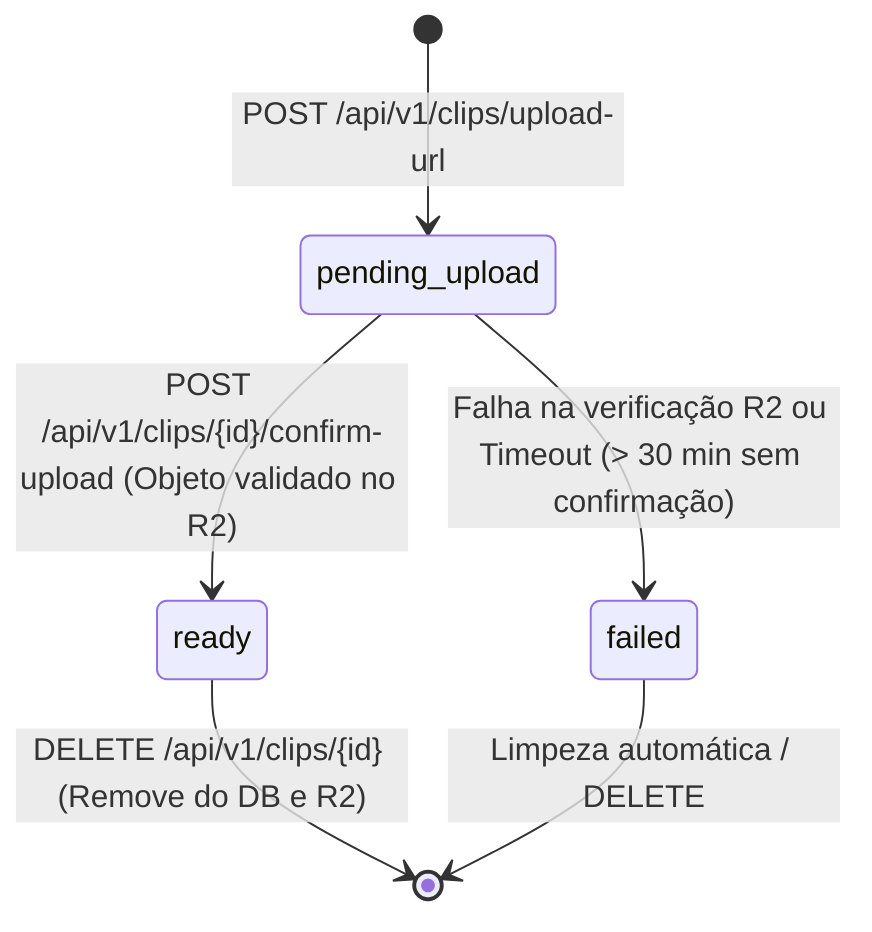

# Product Requirements Document (PRD) — CLIPAÍ Backend API

## 1. Visão do Produto

O **CLIPAÍ** é uma plataforma brasileira de armazenamento, descoberta e compartilhamento de clipes curtos de jogadas (*gaming highlights*). O sistema permite que jogadores façam upload rápido de seus melhores momentos, organizem clipes em coleções (playlists), descubram jogadas por jogo ou tags e compartilhem links diretos com amigos e comunidades.

Este repositório (`clipai-api`) implementa a **API RESTful assíncrona** do CLIPAÍ, desacoplada do frontend (`clipai-web`). Toda a transferência de mídia pesada (vídeos e thumbnails) ocorre diretamente entre o navegador do cliente e o **Cloudflare R2** via **Presigned URLs**, garantindo baixa latência e consumo mínimo de CPU/memória no servidor de aplicação.

---

## 2. Objetivos Técnicos e de Negócio

1. **Custo e Escalabilidade de Banda (Zero Egress / Direct Upload):** Nenhum byte de vídeo ou imagem de thumbnail deve trafegar pelo servidor FastAPI. O backend atua exclusivamente como plano de controle (autenticação, autorização, validação de metadados, assinatura de URLs e persistência relacional).
2. **Experiência Localizada (PT-BR):** Embora toda a engenharia (código, banco de dados, rotas e logs internos) siga o padrão em inglês, todas as mensagens de erro e notificações transacionais destinadas ao usuário final são entregues em português do Brasil (PT-BR).
3. **Segurança desde o MVP:** Hash de senhas com Argon2id, autenticação com JWT de curta duração aliado a Refresh Tokens rotativos em cookies `HttpOnly`, validação rigorosa antes da emissão de URLs pré-assinadas e banco de dados já preparado para autenticação em dois fatores (2FA TOTP).
4. **Qualidade Automatizada:** Cobertura de testes automatizados (`pytest` + `httpx`), linting/formatação via `Ruff` e inspeção contínua de qualidade e segurança pelo **SonarCloud**.

---

## 3. Escopo do Projeto: MVP (v1) vs. Pós-MVP (v1.1 / v2)

| Domínio | Escopo Fechado — MVP (v1.0) | Escopo Pós-MVP (v1.1 / v2.0) |
| :--- | :--- | :--- |
| **Autenticação e Conta** | Registro com e-mail/senha, confirmação de e-mail via Resend, login, refresh token rotativo (`HttpOnly`), logout, recuperação e redefinição de senha. Colunas de 2FA reservadas no banco. | Ativação e validação de **2FA TOTP** (PyOTP / Google Authenticator) na v1.1; Login social via **Discord OAuth2** na v1.1/v2. |
| **Upload e Mídia** | Upload direto para Cloudflare R2 via Presigned `PUT` URL de vídeos `.mp4` e `.webm` (até 100 MB e máx. 120s) + thumbnail (`.jpg`, `.png`, `.webp` até 5 MB). Extração de metadados técnicos no cliente e confirmação no backend. | Transcodificação assíncrona para **HLS** (múltiplas resoluções), geração automática de thumbnail/preview no servidor via workers. |
| **Gestão de Clipes** | CRUD completo de clipes, níveis de privacidade (`public`, `friends`, `unlisted`), vínculo com um jogo (`games`) e múltiplas tags (`tags`). | Recorte (*trim*) online de vídeo, marcação de jogadores presentes no clipe. |
| **Descoberta e Busca** | Listagem paginada de clipes públicos, busca textual por título/descrição, filtros por jogo, tag e autor, ordenação por recentes ou populares. | Feed algorítmico personalizado e recomendações baseadas em histórico. |
| **Social e Engajamento** | Curtidas (`clip_likes`), favoritos (`clip_favorites`), contagem de visualizações (`views_count`) e coleções/playlists de clipes (`collections`). | Sistema de seguir e grafo de **amizades** (habilitando a visibilidade social de `friends`), comentários com timestamp no vídeo, denúncias e painel de moderação. |

---

## 4. Regras de Negócio Detalhadas

### 4.1. Identidade e Autenticação
- **RN-AUTH-01 (Unicidade):** `email` (case-insensitive) e `username` (case-insensitive, formato `^[a-zA-Z0-9_]{3,30}$`) devem ser únicos no sistema.
- **RN-AUTH-02 (Verificação de E-mail):** Usuários recém-cadastrados iniciam com `is_email_verified = false`. O envio de clipes (`POST /api/v1/clips/upload-url`), criação de coleções e interações sociais (curtir/favoritar) exigem `is_email_verified = true`.
- **RN-AUTH-03 (Política de Senha):** Mínimo de 8 e máximo de 128 caracteres, exigindo ao menos uma letra maiúscula, uma letra minúscula, um número e um caractere especial.
- **RN-AUTH-04 (Sessão e Rotação):** O `access_token` JWT expira em **15 minutos**. O `refresh_token` expira em **7 dias**, é armazenado exclusivamente em cookie `HttpOnly` e sofre rotação a cada uso (`POST /api/v1/auth/refresh`), invalidando o token anterior.

### 4.2. Limites e Validação de Upload de Clipes
- **RN-CLIP-01 (Formatos de Vídeo Permitidos):** Apenas `video/mp4` (`.mp4`) e `video/webm` (`.webm`). Qualquer outro MIME type é rejeitado antes de assinar a URL do R2.
- **RN-CLIP-02 (Tamanho Máximo de Vídeo):** **100 MB** (`104.857.600 bytes`).
- **RN-CLIP-03 (Duração Máxima de Vídeo):** **120 segundos** (2 minutos) e duração mínima de **1 segundo**.
- **RN-CLIP-04 (Thumbnail Obrigatória):** Formatos aceitos: `image/jpeg`, `image/png` e `image/webp`, com tamanho máximo de **5 MB** (`5.242.880 bytes`).
- **RN-CLIP-05 (Tags por Clipe):** Cada clipe pode ter no máximo **10 tags**. Nomes de tags são normalizados em `slug` (minúsculas, alfanuméricos e hifens, até 30 caracteres).

### 4.3. Ciclo de Vida de um Clipe (`status`)

Todo clipe transita por uma máquina de estados estrita representada pela coluna `status`:

1. **`pending_upload`:**
   - Criado no momento em que o usuário solicita as Presigned URLs (`POST /api/v1/clips/upload-url`).
   - Clipes neste estado **não aparecem** em nenhuma listagem pública, busca, perfil ou coleção.
   - As Presigned URLs geradas têm validade (TTL) de **15 minutos**.
2. **`ready`:**
   - Atingido exclusivamente após o cliente concluir o upload direto ao R2 e acionar `POST /api/v1/clips/{clip_id}/confirm-upload`.
   - O backend verifica a existência e o tamanho dos arquivos de vídeo e thumbnail no bucket R2 via `HeadObject`. Se íntegros, o status muda para `ready` e o clipe passa a ser visível conforme sua regra de privacidade.
3. **`failed`:**
   - Atribuído quando a validação `HeadObject` no `confirm-upload` constata ausência do arquivo ou divergência de tamanho/MIME type no R2, ou quando um registro permanece em `pending_upload` por mais de **30 minutos**.
   - Clipes `failed` não são exibidos publicamente e seus objetos órfãos no R2 são removidos pela política de ciclo de vida do bucket e/ou rotina de limpeza.

### 4.4. Regras de Privacidade (`privacy`)

Aplicáveis tanto a **Clipes** (`clips.privacy`) quanto a **Coleções** (`collections.privacy`):

| Nível | Listagens Públicas / Busca / Perfil | Acesso via Link Direto (`GET /clips/{id}`) | Regra de Acesso no MVP (v1) |
| :--- | :--- | :--- | :--- |
| **`public`** | Visível para todos (autenticados ou anônimos). | Acessível por qualquer pessoa. | Totalmente aberto para leitura. |
| **`unlisted`** | **Oculto** de buscas, feeds, listagens de jogos/tags e perfil público. | Acessível por qualquer pessoa que possua o link direto (`UUID`). | Ideal para compartilhamento rápido em chats sem indexar na plataforma. |
| **`friends`** | **Oculto** de buscas e feeds públicos. Visível ao dono em seu painel. | Restrito a usuários autorizados. | Como o grafo de amizades será introduzido no **Pós-MVP (v1.1/v2)**, no **MVP (v1)** itens marcados como `friends` são visíveis **apenas para o próprio autor** (funcionando como privado até o lançamento do módulo de amizades). |

### 4.5. Coleções (Playlists)
- **RN-COLL-01:** Um usuário pode criar coleções com título, descrição opcional e nível de privacidade (`public`, `friends`, `unlisted`).
- **RN-COLL-02:** Uma coleção pode conter qualquer clipe com `status = 'ready'` ao qual o dono da coleção tenha acesso, mantendo a ordenação explícita através do campo `position`.
- **RN-COLL-03:** Ao visualizar uma coleção de terceiros, clipes individuais cuja privacidade seja restrita ao autor (ex.: `friends` de outro usuário) são filtrados da resposta.

### 4.6. Curtidas, Favoritos e Visualizações
- **RN-ENG-01 (Idempotência de Curtidas e Favoritos):** Um usuário autenticado pode curtir (`clip_likes`) e favoritar (`clip_favorites`) um clipe apenas uma vez. Os contadores desnormalizados `likes_count` e `favorites_count` na tabela `clips` são atualizados atomicamente na mesma transação.
- **RN-ENG-02 (Lista de Favoritos Privada):** A lista de clipes favoritados por um usuário (`GET /api/v1/users/me/favorites`) é privada e acessível apenas pelo próprio usuário autenticado.
- **RN-ENG-03 (Contagem de Visualizações):** O endpoint `POST /api/v1/clips/{clip_id}/views` incrementa `views_count` em +1. É protegido por rate limit por IP/usuário + `clip_id` para evitar inflação artificial de visualizações.

---

## 5. Fluxos Principais do Sistema

### 5.1. Fluxo de Registro e Verificação de Conta
1. Usuário envia `POST /api/v1/auth/register` com `username`, `email` e `password`.
2. Backend valida dados, aplica hash Argon2id na senha, persiste o usuário com `is_email_verified = false` e dispara e-mail transacional via **Resend** contendo um link com token assinado de verificação (validade de 24h).
3. Usuário clica no link no frontend, que envia `POST /api/v1/auth/verify-email` com o `token`.
4. Backend valida o token e atualiza `is_email_verified = true`.

### 5.2. Fluxo de Upload de Clipe via Presigned URL
1. No frontend (`clipai-web`), o usuário seleciona o vídeo (`.mp4`/`.webm`), o navegador extrai localmente a duração, resolução, FPS e gera/seleciona a thumbnail.
2. Frontend chama `POST /api/v1/clips/upload-url` informando metadados do clipe, tamanhos e MIME types.
3. Backend valida todas as restrições (RN-CLIP-01 a RN-CLIP-05), cria o registro na tabela `clips` com `status = 'pending_upload'` e retorna `clip_id`, `video_upload_url` e `thumbnail_upload_url` (Presigned `PUT` URLs do Cloudflare R2).
4. Frontend faz o upload binário diretamente para o Cloudflare R2 via `PUT` nas duas URLs.
5. Após `200 OK` do R2, o frontend chama `POST /api/v1/clips/{clip_id}/confirm-upload`.
6. Backend consulta os objetos no R2 (`head_object`), confirma tamanho/existência, transiciona o clipe para `status = 'ready'` e retorna os dados públicos do clipe.

### 5.3. Fluxo de Recuperação de Senha
1. Usuário solicita `POST /api/v1/auth/forgot-password` informando seu `email`.
2. Backend sempre responde `200 OK` (prevenindo enumeração de usuários). Se o e-mail existir e estiver ativo, envia link de redefinição via **Resend** com token de uso único (validade de 30 minutos).
3. Usuário submete nova senha em `POST /api/v1/auth/reset-password`.
4. Backend valida o token, atualiza `password_hash` com Argon2id e **revoga todos os `refresh_tokens` ativos** do usuário.
